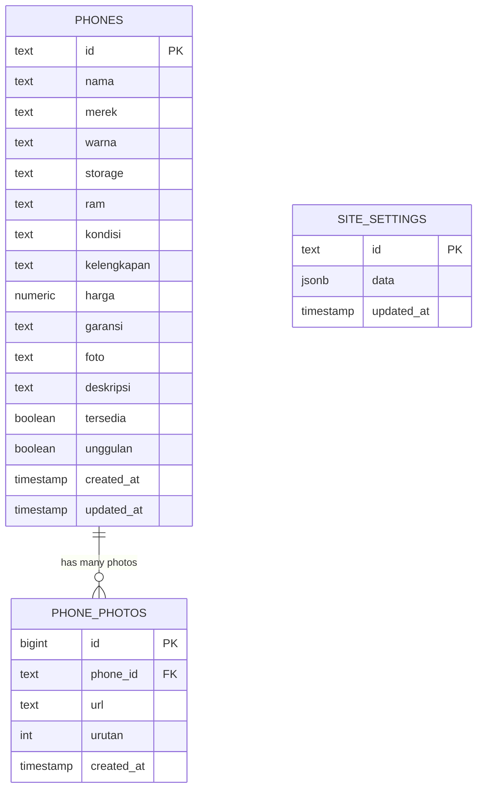

# 📱 HPSEC — Platform E-Commerce & Katalog HP Second Cikarang

<div align="center">


<p align="center">
  <strong>Website katalog e-commerce modern, mobile-first, dan terintegrasi WhatsApp untuk toko jual-beli HP second bergaransi di Cikarang.</strong>
</p>

<p align="center">
  <a href="#-fitur-utama">Fitur Utama</a> •
  <a href="#-tech-stack">Tech Stack</a> •
  <a href="#-arsitektur-proyek">Arsitektur</a> •
  <a href="#-skema-database">Database & Storage</a> •
  <a href="#-panduan-instalasi">Instalasi</a> •
  <a href="#-konfigurasi-supabase">Konfigurasi Cloud</a>
</p>

---

</div>

## 📖 Tentang Proyek

**HPSEC** adalah platform web toko retail jual-beli dan tukar tambah handphone second yang beroperasi di kawasan Sukadami, Cikarang Selatan, Bekasi. Platform ini memfasilitasi transaksi yang aman dan transparan bagi pembeli dengan memaparkan kondisi fisik unit apa adanya (*Mulus, Normal, Ada Minus*), riwayat kelengkapan, masa garansi toko, serta integrasi tombol chat langsung ke WhatsApp penjual (*click-to-chat with pre-filled message*).

Dilengkapi dengan **Dashboard Admin** berbasis cloud yang memudahkan pemilik toko untuk memantau stok, memperbarui harga, mengunggah foto produk, dan memperbarui profil toko secara *real-time*.

---

## ✨ Fitur Utama

### 📱 1. Halaman Publik (Customer Experience)
* **Mobile-First Responsive Layout**: Dioptimalkan secara menyeluruh untuk layar ponsel pintar dengan navigasi intuitif dan layout yang padat serta ramah sentuhan.
* **Katalog Dinamis & Filter Cerdas (`/katalog`)**:
  * Grid produk 2-kolom ringkas di perangkat seluler agar menghemat ruang *scroll*.
  * Pencarian instan berdasarkan merek, tipe model, atau warna.
  * Filter multi-kriteria: Merek, Kondisi (*Mulus, Normal, Minus*), dan Ketersediaan (*In-Stock*).
  * Pengurutan harga (Termurah / Termahal).
* **Detail Produk Lengkap (`/hp/[id]`)**:
  * Galeri foto unit beresolusi tinggi dengan indikator kondisi.
  * Transparansi minus, kelengkapan (*Fullset / Batangan*), dan garansi toko.
  * Tombol **Direct WhatsApp Order** dengan pesan otomatis spesifik unit yang dipilih.
  * Rekomendasi unit serupa dengan harga sebanding.
* **Layanan & Edukasi Konsumen (`/layanan`, `/garansi`, `/tentang`)**:
  * Prosedur jual HP lama, tukar tambah, dan estimasi harga.
  * Checklist pengecekan fisik dan fungsi hardware HP second.
  * Kebijakan garansi toko 1 bulan dan FAQ interaktif.
* **Integrasi Google Maps & Alamat Toko**: Peta interaktif toko fisik di Jl. Bumi Cikarang Makmur untuk memudahkan transaksi COD / kunjungan langsung.

### 🔐 2. Dashboard Admin (Back-Office Management)
* **Autentikasi Aman**: Login berbasis Supabase Auth dengan proteksi sesi dan redirect otomatis.
* **Statistik & Overview Stok (`/admin`)**: Metrik ringkasan jumlah unit aktif, unit terjual, dan status persediaan.
* **Manajemen Inventaris (`/admin/phones`)**:
  * Tambah unit baru dengan generator Slug URL otomatis.
  * Quick-toggle status: Ubah status **Tersedia / Terjual** atau tandai **Unggulan** hanya dengan 1 klik.
  * Form edit data lengkap (nama, merek, storage, RAM, kondisi, kelengkapan, harga, garansi, deskripsi).
* **Upload Foto Cloud**: Unggah foto unit langsung ke Supabase Storage (`phone-images`) dengan sanitasi nama berkas dan auto-refresh preview.
* **Pengaturan Toko Terpusat (`/admin/site`)**: Pembaruan nomor kontak WhatsApp, jam operasional, alamat fisik toko, dan tautan sosial media.

---

## 🛠️ Tech Stack

| Kategori | Teknologi | Kegunaan |
|---|---|---|
| **Core Framework** | [Next.js 16](https://nextjs.org/) (App Router & Turbopack) | Server-Side Rendering (SSR), Server Components, dan dynamic routing performa tinggi |
| **Language** | JavaScript (ES6+) / React 19 | Logika aplikasi frontend & komponen modular |
| **Styling** | Vanilla CSS (CSS Modules & Custom Properties) | Zero runtime overhead, desain kustom dengan palet warna HSL bernuansa warm editorial |
| **Backend as a Service** | [Supabase](https://supabase.com/) (PostgreSQL 15+) | Database relational, Row Level Security (RLS), dan Storage API |
| **Authentication** | Supabase Auth | Pengelolaan login admin berbasis JWT & session cookies |
| **Asset Storage** | Supabase Storage Bucket | Hosting gambar produk publik berkecepatan tinggi |
| **Icons** | Custom Handcrafted SVG | Ringan tanpa library pihak ketiga (tanpa FontAwesome/Lucide bundle bloat) |

---

## 🏗️ Arsitektur Proyek

Struktur folder dirancang mengikuti konvensi **Next.js App Router**:

```text
hpsec-web/
├── public/                     # Aset statis publik (favicon, robots.txt, gambar default)
├── src/
│   ├── app/                    # Routing halaman (App Router)
│   │   ├── admin/              # Rute Dashboard Admin & manajemen inventaris
│   │   │   ├── phones/         # CRUD unit HP (tabel, tambah, edit)
│   │   │   └── site/           # Pengaturan profil & kontak toko
│   │   ├── hp/[id]/            # Halaman detail unit HP
│   │   ├── katalog/            # Halaman katalog produk & filter pencarian
│   │   ├── layanan/            # Halaman layanan jual beli & tukar tambah
│   │   ├── garansi/            # Halaman kebijakan garansi & cek fisik
│   │   ├── tentang/            # Profil dan komitmen toko
│   │   ├── kontak/             # Lokasi toko & Google Maps
│   │   ├── login/              # Halaman login administrator
│   │   ├── globals.css         # Design system global, token CSS, dan reset
│   │   └── page.js             # Homepage / Landing page utama
│   ├── components/             # Reusable UI components
│   │   ├── admin/              # Komponen khusus admin (PhoneForm, AdminSidebar)
│   │   ├── Header.js           # Navigasi utama & drawer mobile
│   │   ├── Footer.js           # Footer responsif & ringkas
│   │   ├── PhoneCard.js        # Kartu produk dinamis (standard & compact)
│   │   ├── FloatingWA.js       # Tombol melayang WhatsApp cepat
│   │   └── Icons.js            # Kumpulan icon SVG native
│   ├── data/                   # Fallback data lokal (phones.json & site.json)
│   └── lib/                    # Utilitas & koneksi database
│       ├── phones.js           # Data-layer hybrid (Supabase query + local fallback)
│       ├── utils.js            # Helper format mata uang (IDR), sanitasi slug, URL WhatsApp
│       └── supabase/           # Inisialisasi Supabase client & server helper
└── supabase/
    └── migration.sql           # DDL Skrip SQL skema tabel, RLS policy, dan trigger
```

---

## 🗄️ Skema Database

Sistem menggunakan database PostgreSQL yang dikelola oleh Supabase dengan skema sebagai berikut:



### Keamanan Row Level Security (RLS)
* **Tabel `phones` & `site_settings`**:
  * Operasi `SELECT`: Terbuka untuk umum (`anon` & `authenticated`).
  * Operasi `INSERT`, `UPDATE`, `DELETE`: Dibatasi secara ketat hanya untuk admin yang terotentikasi (`authenticated`).
* **Supabase Storage (`phone-images`)**:
  * *Public Read*: Foto dapat diakses publik melalui CDN Supabase.
  * *Authenticated Upload*: Hanya sesi admin yang diizinkan mengunggah dan menghapus foto.

---

## 🚀 Panduan Instalasi & Menjalankan Lokal

### Prasyarat
* [Node.js](https://nodejs.org/) versi `18.18.0` atau yang lebih baru
* Package Manager `npm` (atau `pnpm` / `yarn`)

### Langkah-langkah

1. **Clone repository & masuk ke direktori web:**
   ```bash
   git clone <URL_REPOSITORY_ANDA>
   cd "Hpsec desain baru/hpsec-web"
   ```

2. **Install dependensi:**
   ```bash
   npm install
   ```

3. **Salin berkas Environment:**
   ```bash
   cp .env.local.example .env.local
   ```

4. **Jalankan development server:**
   ```bash
   npm run dev
   ```

5. **Buka di peramban:**
   * Website Utama: [http://localhost:3000](http://localhost:3000)
   * Katalog: [http://localhost:3000/katalog](http://localhost:3000/katalog)
   * Dashboard Admin: [http://localhost:3000/admin](http://localhost:3000/admin)

---

## ⚙️ Konfigurasi Cloud Supabase

Platform ini memiliki mekanisme **Hybrid / Resilient Architecture**. Jika environment Supabase belum diisi, website otomatis tetap berjalan normal membaca data lokal (`src/data/phones.json`).

Untuk mengaktifkan database live:

1. **Buat Proyek di Supabase**:
   * Kunjungi [database.new](https://database.new) dan buat project baru.
2. **Eksekusi Skrip Migrasi**:
   * Buka menu **SQL Editor** pada Supabase.
   * Salin seluruh isi file [`supabase/migration.sql`](./supabase/migration.sql) dan jalankan (**Run**).
3. **Konfigurasi Storage Bucket**:
   * Masuk ke menu **Storage** > **New Bucket**.
   * Beri nama `phone-images` dan centang opsi **Public Bucket**.
4. **Buat Akun Administrator**:
   * Buka menu **Authentication** > **Users** > **Add User** > **Create User**.
   * Masukkan email dan password pilihan Anda.
5. **Konfigurasikan `.env.local`**:
   Buka **Project Settings** > **API** di Supabase, lalu masukkan kredensial:
   ```env
   NEXT_PUBLIC_SUPABASE_URL=https://xxxxxxxxxxxx.supabase.co
   NEXT_PUBLIC_SUPABASE_ANON_KEY=eyJhbg...
   SUPABASE_SERVICE_ROLE_KEY=eyJhbg...
   ```

---

## 📋 Daftar Perintah NPM

| Perintah | Deskripsi |
|---|---|
| `npm run dev` | Menjalankan server lokal Next.js dengan Hot Module Replacement (HMR) di `localhost:3000` |
| `npm run build` | Melakukan kompilasi dan optimasi produksi (*Production Build*) |
| `npm run start` | Menjalankan server aplikasi Next.js dalam mode produksi |
| `npm run lint` | Menjalankan static code analysis menggunakan ESLint |

---

## 📱 Mobile-First Design Principles

* **Touch Targets Ramah Jari**: Tombol aksi berukuran minimal `44px × 44px` untuk meminimalkan salah sentuh.
* **Ultra-Compact Footer**: Tampilan footer mobile dipadatkan hingga 50% lebih ringkas dengan navigasi multi-kolom dan eliminasi tombol duplikat.
* **Fluid Typography & Spacing**: Menggunakan skala modular variabel CSS dengan satuan `clamp()` dan `rem` yang menyesuaikan proporsi layar.
* **Smooth Micro-Interactions**: Transisi CSS native tanpa library pihak ketiga yang berat untuk menjamin render 60 FPS pada smartphone kelas pemula sekalipun.

---

## 📄 Lisensi & Hak Cipta

Dibuat untuk keperluan toko **HPSEC Cikarang** & Tugas Proyek Bisnis Elektronik.  
Seluruh hak cipta dilindungi undang-undang &copy; 2026 **HPSEC**.
